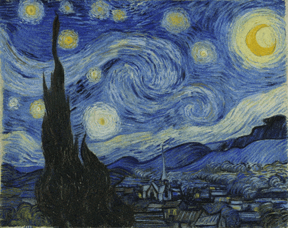
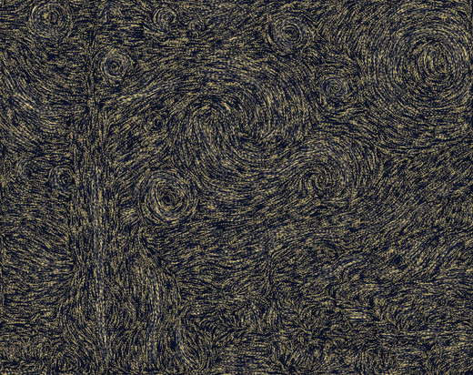

# 流动的星夜 · Flowing Starry Night

让梵高《星月夜》的笔触沿着它自己的方向流动起来。纯 WebGL2 shader + 少量经典图像处理，没有神经网络，单个 HTML 文件，双击就能打开。

*Van Gogh's "The Starry Night", set in motion along its own brush strokes. WebGL2 shaders plus classic image processing, no neural network, one self-contained HTML file.*



上图是仓库内置预设的实际效果（1280×1014 原尺寸，用浏览器 GPU 逐帧录制，无缝循环）：流速 0.38×、笔触位移 60 px、光流 0.10、鼠标搅动 0，外加 25 条手绘引导箭头。GIF 约 49 MB，加载慢时可以看同一段的 [MP4](docs/demo.mp4)。

在线演示：见仓库右侧 About 里的链接（GitHub Pages）。也可以下载 `index.html` 直接用浏览器打开。

## 原理

1. **求笔触方向。** 对亮度做 Sobel 梯度，构造结构张量 `J = ∇I∇Iᵀ` 并高斯平滑。次特征向量就是笔触切线；两个特征值之差给出这里的笔触有多清晰，决定流速。
2. **统一流向。** 张量只给出笔触所在的“线”，没有“箭头”。每个 4 px 格子先自成一块，再反复合并“整条公共边界上证据最强”的两块相邻区域，必要时把其中一块整体翻向（带符号的凝聚聚类）。证据综合考虑走向是否平行、笔触清晰度和区域颜色，所以一整圈光晕、一条长笔触会朝同一个方向走，相邻的平行笔触趋于同向。
3. **引导箭头。** 自动推断猜错的地方，可以手绘箭头。箭头作为固定锚点参与同一套聚类投票，整片相连的笔触都会跟着改向；箭头正下方的方向也会被轻微拉向箭头。
4. **沿流线回溯采样。** 片元着色器从每个像素出发沿方向场逆流积分若干步再取色，两个相位交叉淡入，循环播放而不漂移。
5. **动态 LIC 光流。** 稀疏噪点沿流线做线积分卷积，卷积核随时间平移，亮色笔触里有光点顺着线条游动。



## 使用

| 控件 | 作用 |
| --- | --- |
| 流速 / 笔触位移 / 光流 / 鼠标搅动 | 动画参数 |
| 对比原画 | 左半边显示静止原画，右半边显示流动效果 |
| 显示流场 | 用 LIC 纹理直接显示推断出的方向场 |
| 流向反转 | 整体反向 |
| 绘制箭头 | 在画上顺着笔触拖一笔，指定那片笔触的流向；点“完成”后图层隐藏，箭头继续生效 |
| 保存预设 / 恢复默认 | 保存参数和箭头到本机浏览器；“恢复默认”回到仓库内置预设 |
| 上传图片 | 拖入、粘贴或选择任意图片，同样会分析笔触方向（箭头只保存给原作） |

需要支持 WebGL2 的浏览器（最新的 Chrome、Edge、Firefox、Safari）。

## 文件

```
index.html                  完整作品（原作图像与内置预设都嵌在里面）
docs/demo.gif               README 里的动画（内置预设，无缝循环，1280×1014）
docs/demo.mp4               同一段动画的 H.264 版（1280×1014，体积更小）
docs/flow-field.png         流场可视化截图
docs/starry-night-1600.jpg  原作缩小图（1600 px）
```

## 图像来源与许可

- 文森特·梵高《星月夜》（1889，纽约现代艺术博物馆藏），图像来自 [Wikimedia Commons · Google Art Project](https://commons.wikimedia.org/wiki/File:Van_Gogh_-_Starry_Night_-_Google_Art_Project.jpg)，属于公有领域。
- 代码以 [MIT](LICENSE) 许可发布。
